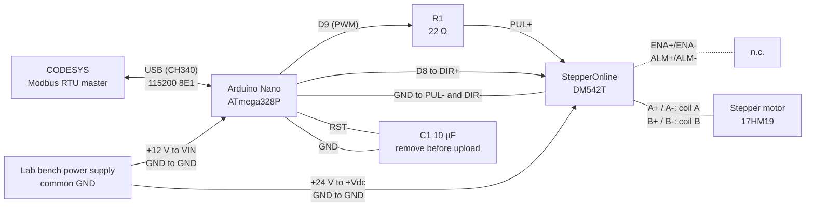

# DM542T Modbus Controller

## Introduction
A while back, I've partially built the BCN3D Moveo as a personal side project. (see https://github.com/BCN3D/BCN3D-Moveo). Unfortunately, at the time I didn't have any Arduino Mega to test it out, and mostly wanted to integrate it with ROS2, but never got to do it. 

Lately I've been having some extra time so I decided to go back to it, and realized  that I could use this robot as a test bench for Codesys Projects involving robotics, plus it sounds like a fun side project. 

I have some StepperOnline DM542T drivers laying around and some Arduino Nano clones, as well as an old RPI3B+, hence how I got to try to develop this controller. 

## Documentation:
* [Test Results & Dev docs](Tests%20%26%20Results.md)

## Architecture
*TBD*

## Tools:
*  [ModbusTool](https://github.com/ClassicDIY/ModbusTool.git) for testing serial communication 

## Build & Dependencies
| Item | Version / Setting |
|---|---|
| MCU | ATmega328P @ 16 MHz (Arduino Nano clone, CH340 USB, micro-USB) |
| Board setting | Arduino Nano, Processor: ATmega328P (Old Bootloader) |
| Arduino AVR core | arduino:avr 1.8.8 |
| IDE | Arduino IDE 2.3.10 (arduino-cli 1.5.1) |
| Libraries | [Modbus-Serial](https://github.com/epsilonrt/modbus-serial) 2.0.6, [Modbus-Arduino](https://github.com/epsilonrt/modbus-arduino) 1.3.0 (dependency) |
| Serial | USB, 115200 baud, 8E1 |

> **WARNING:** Remove the 10 µF capacitor between RST and GND before uploading firmware (see [Troubleshooting](Tests%20%26%20Results.md#troubleshooting)).

## Wiring
Dashed lines are not connected (floating).

## Known Issues
* Starting/stopping PWM (`pwmOn`/`pwmOff`) can cut or emit a partial STEP pulse (±1 step per start/stop). Planned fix: start/stop via OCR1x = 0 in mode 8.
* `mb.task()` blocks for ~3–4 ms per Modbus request.
* Frequency registers are 16-bit, so values above 65 535 Hz can't be written in one register.
* Pin D10 has a PWM channel but no DIR pin yet.

---

## Changelog
### V0.1 Default Arduino analogWrite
* Added modbus support using the Arduino provided [Modbus-Serial Lib](https://github.com/epsilonrt/modbus-serial)
* Tested modbus function using [Modbus Tool](https://github.com/ClassicDIY/ModbusTool.git)
* Added prototype for own pwm function
* Added simple analogWrite on modbus trigger. 

### V0.2 Bit-Banging PWM
* Added a bit-banged PWM function (per [Secrets of Arduino PWM](https://docs.arduino.cc/tutorials/generic/secrets-of-arduino-pwm/))
* Added the Test & Results doc and first oscilloscope evidence (analogWrite vs bit-banging)
* Cleaned unused code blocks

### V0.3 Direct PWM via Timer1
* PWM generated directly by Timer1 on pins 9/10; removed all previous PWM generation methods
* Added `ADDR` namespace for Modbus addresses (now in HEX) and `PWM` namespace for PWM data
* Added Modbus addresses for duty, frequency and on/off coils
* Added `pwmOn()`/`pwmOff()` to connect/disconnect Timer1 from pin 9, 10 or both
* Fixed 500 Hz / 50% duty for testing; recorded evidence
* Removed the versioning header from the sketch (changelog is kept here)

### V0.4 Control Word & Register Expansion
* Added more Modbus addresses for motor control and PWM parameters (TOP, CS, limits, ...)
* Added signal generation constraints (122 Hz to 20 kHz for this setup)
* `pwmOn()`/`pwmOff()` now only validate the command and update the status word; `updatePins()` applies it to the port/timer
* Added a wrapper for the on/off control word to avoid redundant code
* Tested with a 22 Ω series resistor: overshoot reduced to ~5%

### V0.5 Timer Setup & Frequency Change
* Added `setTimer()`: sets all Timer1 registers in an atomic block, picks the best prescaler for the operating mode, sets pin modes
* Added helpers for the WGM control bits per mode and for converting duty to OCR
* Split frequency handling:
    * `setPWMFrequency()` sets the frequency and (re)configures the timer; meant for `setup()` or fixed frequencies
    * `changePWMFrequency()` changes the frequency while the timer runs; meant for `loop()` or interrupts
* Glitch-free frequency change: a higher TOP is written directly, a lower TOP is applied by the Timer1 overflow ISR at the next BOTTOM (no ±1 step, ~1 period delay)
* `setPWMDuty()` now also applies the value to the registers
* Added actual-frequency register and Modbus frequency data
* Added default frequency limits (125 Hz to 20 kHz) and lo/hi limit registers; invalid limits fall back to the defaults
* Fixed: duty stored unclamped when set above 100%
* Fixed: requested frequency not recorded when the new TOP equals the old one
* Fixed: duty not recorded before the timer is configured

## Target Requirements
| ID | Category | Requirement | Status |
|---|---|---|---|
| COM-1 | Communication | Stable Modbus RTU communication at 115200 baud, 8E1, over USB serial | Met |
| COM-2 | Communication | CODESYS compatibility as a Modbus slave | Met |
| PWM-1 | PWM generation | Frequency within ±5% of target | Met at 500 Hz (V0.4); wider range not tested yet |
| PWM-2 | PWM generation | Duty cycle within ±5% of target | Met at 50% (V0.4) |
| PWM-3 | PWM generation | Variable frequency up to 200 kHz (DM542T limit), 50% duty recommended, minimum pulse width 2.5 µs | Partial: 125 Hz to 20 kHz by default |
| PWM-4 | PWM generation | Ramping, to avoid current spikes from the motor | Planned |
| PWM-5 | PWM generation | Configurable timer: PWM ported to a library so each object can be attached to a timer (e.g. `pwm1.attach(timer1)`, `pwm2.attach(timer2)`) | Planned |
| SAF-1 | Safety | Communication watchdog: stop pulse generation if no Modbus request is received within a configurable timeout | Open |
| SAF-2 | Safety | Safe state at power-up and reset: PWM off and outputs LOW until explicitly started by the master | Implemented in `setup()`, not verified |
| SAF-3 | Safety | MCU watchdog (WDT): reset into the safe state if the firmware locks up | Open |
| SAF-4 | Safety | Direction changes only while stopped, or with DIR stable at least 5 µs before the next step edge (DM542T spec) | Open |
| SAF-5 | Safety | Defined stop behaviour: normal stop (ramped, once ramping exists) and emergency stop (immediate) | Open |
| MOT-1 | Motion control | Step counting: emitted-step counter and/or "move N steps" command for open-loop positioning | Open |
| MOT-2 | Motion control | Up to 2 independent axes per Nano (one per free timer: Timer1, Timer2) | Planned |
| MOT-3 | Motion control | 2 synchronized axes on one timer (pins 9 and 10 driven at the same frequency) | Implemented (Timer1) |
| MOT-4 | Motion control | Configurable motion parameters: speed, acceleration, direction | Planned |
| CTL-1 | Control | Error handling and reporting | Open |
| DIA-1 | Diagnostics | Error/status register with defined error codes, including the reason a command was rejected | Open |
| DIA-2 | Diagnostics | Firmware version register | Open |
| DIA-3 | Diagnostics | Communication error counters (CRC errors, timeouts) | Open |
| CFG-1 | Configuration | Input validation: out-of-range writes are rejected or clamped, and the result is reported | Partial: frequency limits |
| CFG-2 | Configuration | Persistent settings in EEPROM (limits, slave ID, baud rate); lowest priority | Planned |
| TIM-1 | Timing | Interrupts disabled for at most 100 µs at a time, so Modbus at 115200 baud doesn't lose bytes | Open, not measured |
| TIM-2 | Timing | Frequency change applied within one PWM period | Implemented (V0.5), not measured |
| REG-1 | Modbus registers | Start/stop PWM | Implemented |
| REG-2 | Modbus registers | Duty setpoint | Implemented |
| REG-3 | Modbus registers | Direction change | Implemented |
| REG-4 | Modbus registers | Frequency setpoint | Implemented |
| REG-5 | Modbus registers | Frequency feedback | Implemented |
| REG-6 | Modbus registers | Frequency generation lower/upper boundaries | Implemented |
| REG-7 | Modbus registers | Connected drive capabilities | TBD |
| REG-8 | Modbus registers | Connected motor capabilities | TBD |
