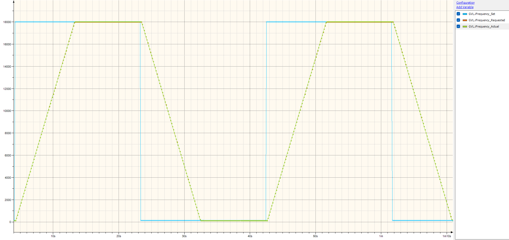
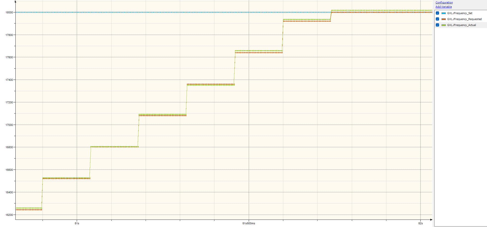

# Tests & Results Report

## 1. Modbus Communication
#### 1.1 Modbus RTU

**Frequency sweep from Codesys**

For a first test I made a simple frequency sweep in Codesys: the frequency setpoint (holding 0x05) is set to 18000Hz, and once the ramp is done it is set back to 125Hz, then the direction is changed and it starts again. The Nano ramps between the two at 2000Hz/s.

There are 3 frequency values that can be read over Modbus, and it's easy to mix them up:
* **Setpoint** (holding 0x05): the target frequency written by Codesys.
* **Requested** (input 0x05): the current position of the ramp, after the lo/hi limits. Once the ramp is done it is equal to the setpoint (unless the setpoint is outside the limits). 
* **Actual** (input 0x06): the frequency calculated back from the rounded TOP value, so what is actually on the pin. It is never exactly the requested frequency, e.g. 18000Hz gives TOP = 444 and an actual frequency of 18018Hz.

The graph below is simulated from the formulas in the library (not measured yet), with prescaler 1 and the values truncated to whole Hz, like they are read over Modbus.


* On the full sweep, actual and requested overlap, the difference is too small to see.
* Zoomed in on the end of the ramp, the requested frequency is a straight line, while the actual frequency moves in steps of ~40Hz, one for each TOP value.
* The rounding error grows with the square of the frequency ($\Delta f_{max} \approx \pm f^2 / f_{clk}$ at prescaler 1): under 1Hz below 4kHz, ~18Hz at 18kHz and ~25Hz at 20kHz.

Measuring the frequency via the Modbus Register map specified before using Codesys Trace gives the expected simulated results:

The indication on the difference between the 3 frequency variables is clearer when zoomed in when reving up:


**Frequency sweep measured with the oscilloscope**

The Codesys trace only shows the values from the registers, so I also measured the sweep directly on the PUL pin (D9), with the same test setup as in the PWM Generation section (only CH1 connected). I made 2 captures with 25M points each:
* ~42s at 2us sampling, for the full sweep
* ~19s at 0.8us sampling, for the zoom on the end of a ramp

The frequency is calculated from the time between the rising edges, averaged over 5ms (2ms in the zoom). The raw CSV files are ~350MB each, so they are in Test-Results compressed with xz (~18MB each, `xz -dk file.csv.xz` or 7-Zip to extract).


|                   | Measured      | Calculated            | Ratio  |
|-------------------|---------------|-----------------------|--------|
| Top plateau       | 17958Hz       | 18018Hz (TOP = 444)   | 0.9967 |
| Bottom plateau    | 124.6Hz       | 125.0Hz (TOP = 64000) | 0.9968 |
| Ramp (3 ramps)    | 1987.3Hz/s    | 2000Hz/s              | 0.9936 |
| Ramp duration     | 8.94 - 8.96s  | 8.94s                 |        |

* The steps of ~40Hz from the simulation are also there in the measurement, and they line up with the frequency calculated from TOP (RMS difference 9.9Hz, which is about the resolution of the measurement: +-1 sample of 0.8us in a 2ms window).
* All the frequencies are ~0.33% lower than calculated. The same offset is in the V0.3 / V0.4 measurements (500Hz measured as ~498.4Hz), so it comes from the board and not from the code: the 16MHz clock of the Nano clone runs slightly slow (most likely a ceramic resonator, which is only accurate to ~0.5%).
* The ramp is ~0.64% slower than set. This is the same clock offset counted twice: once in the pulse frequency and once in millis(), since every ms of the Nano is slightly longer (0.9967² ≈ 0.9936).
* The ramp duration matches the calculation, so the 10ms cap on the elapsed time in rampPWMFrequency() is never hit and the ramp is not slowed down by mb.task() blocking.
* The frequency stays ~0.7s at each end of the sweep before the next ramp starts. This is the time for the whole loop: Codesys reads the requested frequency, sees that the ramp is done and writes the new setpoint. This is a lot slower than expected and still needs to be checked (Codesys Modbus channel cycle times, and a capture of D0/D1 to see the requests and responses).

**Codesys trace vs oscilloscope**

To see how close the value read over Modbus is to what is on the pin, I recorded the same sweep with the Codesys trace (GVL.iFrequency_Actual, input 0x06, traced every 4ms) and with the oscilloscope at the same time (~40s at 2us sampling). The "Frequency Values" channel (input 0x05 - 0x06) is set to 100ms in Codesys.

The two recordings don't share a clock, so they are aligned by matching every value from Codesys with the moment the pin reached that frequency (after correcting the 0.33% clock offset). Over 246 values the delay stays constant within +-10ms (sd 3ms), which is about the resolution of the 2 recordings. The absolute delay between the Nano and Codesys can't be measured this way (it would need a signal recorded by both, e.g. the DIR pin on a second channel), so the graph is aligned with the most recent value at 0 delay.


* The actual frequency register is updated in Codesys every **140ms**, not every 100ms like it is set in the channel. Codesys writes all 4 write channels cyclically, even if nothing changes, so there are 8 requests every 100ms (4 writes, 2 reads every 100ms and 1 read twice at 50ms). If one request takes ~17.5ms, the queue never empties and every channel ends up at 140ms.
* While ramping, the value in Codesys is behind the pin by 0 up to ~280Hz (1987Hz/s * 140ms). It reads lower when ramping up and higher when ramping down.
* On the 18kHz plateau, Codesys reads 57Hz higher than the pin (18018Hz vs 17958Hz). This is the clock offset from before, the firmware calculates with exactly 16MHz.
* At 125Hz the difference is ~0.4Hz.

So anything Codesys decides based on the requested or actual frequency is up to 140ms old. Writing the setpoints only on rising edge and reading all input registers in one request should bring this down.

#### 1.2 Modbus TCP
I currently have a ENC28J60 Ethernet Shield for the Arduino Nano. The distributor I got it from doesn't have any schematics for it, and since it's a cheap one I can't really find any so far. My concern is that the ENC28J60 chip might be using D10 for communication with the board, which means that one PWM pin would be lost. If this is the case, then I will not develop ModbusTCP communication yet. 

## 2. PWM Generation
**Test setup:** Rigol DHO814 oscilloscope, standard probe, DM542T connected, motor as load.

**Note:** The rise time values were measured incorrectly and will be re-measured.

| Project Version 	| Frequency (Target) 	| Frequency (Result) 	| Pulse Duty (Target) 	| Pulse Duty (Result) 	| Overshoot % 	| Rise Time	| Evidence File|
|-----------------	|--------------------	|--------------------	|---------------------	|---------------------	|-------------	|--------	|------------- |
|V0.1-AnalogWrite()	|      500Hz (default)|        488.6       	|         50%         	|        50.2%        	|      13-14%  	|   244ns	| [evidence_00_V0.1](Test-Results/evidence_00_V01.png)|
|V0.2-Bit-Banging 	|      500Hz (default)|      486.25        	|         50%         	|        53.4%        	|      13-14% 	| 25.575ns| [evidence_01_v0.2](Test-Results/evidence_01_V02.png)|
|V0.3-Timer1 PWM  	|      500Hz         	|       498.41       	|       50%           	|          50.0%      	|      14%    	|    64ns	|[evidence_02_V03](Test-Results/evidence_02_V03.png)|
|v0.4-Timer1 PWM  	|      500Hz         	|        498.43      	|           50%       	|             50%     	|      5%     	|     96ns|[evidence_03_v04](Test-Results/evidence_03_V04.png)|
<!-- |                 	|                    	|                    	|                     	|                     	|             	|        	|              | -->
<!-- |                 	|                    	|                    	|                     	|                     	|             	|        	|              | -->


## 3. Observations & Troubleshooting
<details><summary>Testing: analogWrite() vs Bit-Banging</summary>
Both methods would yield acceptable performance for simple PWM tasks (e.g. LED intensity control), and bit-banging seems to be a good alternative when you need to generate some PWM when no actual PWM pins are available. 

### Bit-Banging
Bit-banging is useful when there is the need of changing the frequency on the fly, like in this project. However, in the current very trivial implementation (ignoring shared static state of the function), this method has a few downsides:
* The used millisecond resolution will not accurately give the correct result because integer resolution is used, and the highest possible frequency in this case is 1kHz:
```C
   if (freq != lastFreq){
      lastFreq = freq;
      interval_ms = 1000/freq;
   }
```
* millis() slowly creates a drift because it throws away the overshoot

### AnalogWrite()
* The measured waveform is correct and within decent margins
* Frequency cannot be changed since this method is linked to the timer directly. If frequency change is a requirement, it will be more precise to work with the timer directly. 

So far, none of these two methods seem good enough for the purpose of this project, therefore I will continue to implement one the timers from the Atmega chip.
The Atmega chip has 3 timers (T0, T1, T2); internally T0 is used for the integrated time function and I would like to keep the functionality for now, therefore only T1 and T2 are usable. 
</details>

<details><summary>Comparison between the 3 tested methods</summary>

The following values (and the ones found in the evidence folder) are the avg. values measured by the oscilloscope over a count of 1000 samples.

| Function Used   	| Frequency Deviation	| Pulse Duty Deviation	| Overshoot % 	| Rise Time	|
|-----------------	|--------------------	|--------------------	|-------------	|--------	|
| analogWrite()   	|      11.4Hz        	|        0.2%        	|    13-14%   	|  244ns 	|
| Bit-Banging     	|      13.75Hz       	|        3.4%        	|    13-14%   	| 25.575ns  |
| Direct PWM      	|       1.6Hz        	|        0.0%        	|    13-14%   	|   64ns  	|

For this application's use case, I will continue with Direct PWM method, since it shows the most accurate frequency control. Rise time and overshoot can be corrected by improving the hardware setup.

After adding a 22Ohms resistor on the PWM output pin (PIN9) and powering the Arduino Nano via the VIN pin at 12V, the overshoot is lowered to a steady ~4-5% with a rise of ~12.5ns, which is well within my expectations.

</details>


<details open><summary>Connecting pins to timers</summary>

**Sources**: 
* [Secrets of Arduino PWM](https://docs.arduino.cc/tutorials/generic/secrets-of-arduino-pwm/)
* [Controllerstech Tutorial on Arduino PWM](https://controllerstech.com/arduino-pwm-analogwrite-tutorial/)

### Pinout
|   Timer   |   Pins    |  Base Frequency   |   Dependencies          |   Prescaler Options   |
|-----------|-----------|-------------------|-------------------      |-----------------------|
|   Timer0  |   5 & 6   |  16MHz            |Arduino Time Functions   |          5            |                       
|   Timer1  |   9 & 10  |  16MHz            |   None                  |          5            |
|   Timer2  |   3 & 11  |  16MHz            |   None                  |          7            |

<!-- ### Registers  -->


### Formulas
**Current Output Frequency** 
$$ f = \frac{f_{clk}}  {(2 * prescaler * top)} $$
**TOP Value:** 
$$ Top = \frac{f_{clk}}{(2*prescaler*f)}$$

The two formulas above are the mode 8 / mode 10 case. The full set used in the code ($f_{clk}$ = 16 MHz):

**General output frequency** (`setTimer`)
$$ f = \frac{f_{clk}}{k \cdot prescaler \cdot (TOP + offset)} $$

| PWM_MODE | AVR mode | k | offset | Formula |
|---|---|---|---|---|
| `FAST_PWM_PH_CORRECT` & `PH_CORRECT`| 8 & 10 | 2 | 0 | $f = \frac{f_{clk}}{2 \cdot prescaler \cdot TOP}$ |
| `CTC` | 12 | 2 | 1 | $f = \frac{f_{clk}}{2 \cdot prescaler \cdot (TOP + 1)}$ |
| `FAST_PWM` | 14 | 1 | 1 | $f = \frac{f_{clk}}{prescaler \cdot (TOP + 1)}$ |

**TOP value** (general form, rounded to an integer)
$$ TOP = \operatorname{round}\left(\frac{f_{clk}}{k \cdot prescaler \cdot f} - offset\right) $$

**Actual frequency** (recalculated from the rounded TOP, so it can differ slightly from the request)
$$ f_{actual} = \frac{f_{clk}}{k \cdot prescaler \cdot (TOP + offset)} $$

**Prescaler choice:** the smallest $prescaler \in \{1, 8, 64, 256, 1024\}$ for which $$ TOP \le 65535 $$
Clock-select bits: $CS12{:}10 = index + 1$ (1 = /1, 2 = /8, 3 = /64, 4 = /256, 5 = /1024).

**Valid TOP range**
* `setTimer`: $2 \le TOP \le 65535$
* `changePWMFrequency`: $40 \le TOP \le 65535$, current prescaler only

**NORMAL mode** (TOP fixed at 0xFFFF, only the prescaler matters)
$$ f = \frac{f_{clk}}{65536 \cdot prescaler} $$
The code picks the prescaler with the smallest error $\lvert f_{prescaler} - f_{req} \rvert$. This is the overflow rate; the pin toggles once per overflow, so the signal on the pin is half this frequency.

**Duty to compare value** (`dutyToOCR`, $D$ = 0.0 to 1.0)
* Modes 8 and 10: $$ OCR = \operatorname{round}(D \cdot TOP) $$
* Mode 14: $$ OCR = \min\left(\operatorname{round}(D \cdot (TOP + 1)),\ TOP\right) $$
* NORMAL and CTC: $OCR = 0$ (duty not used)

**Duty to/from Modbus register** (percent)
$$ D = \frac{reg_{duty}}{100} \qquad reg_{duty} = D \cdot 100 $$

**Frequency clamp** (`setPWMFrequency`)
$$ f = \min\left(\max(f_{req},\ f_{lo}),\ f_{hi}\right) \qquad f_{lo} = 125\ \text{Hz},\ f_{hi} = 20000\ \text{Hz} $$
These are the defaults. The limits are read from the lo/hi limit registers; if a limit is invalid, the default is used.

**ISR condition for writing the new TOP** (`TIMER1_OVF_vect`)
$$ TCNT1 + 10 < TOP_{new} $$

#### Limits derived from the formulas (modes 8/10)

**Frequency range for one prescaler**
$$ \frac{f_{clk}}{2 \cdot prescaler \cdot 65535} \le f \le \frac{f_{clk}}{2 \cdot prescaler \cdot TOP_{min}} $$
With $prescaler = 1$: about 122.07 Hz up to 200 kHz ($TOP_{min} = 40$). Just below 122.07 Hz, `setTimer` switches to prescaler 8.

**Pulse width** (DM542T needs at least 2.5 µs high and low)
$$ t_{high} = \frac{D}{f} \qquad t_{low} = \frac{1 - D}{f} $$

**Frequency error from rounding TOP** (worst case, half a count)
$$ \frac{\Delta f}{f} \le \frac{1}{2 \cdot TOP} $$
For example: 0.03% at 5 kHz (TOP = 1600), 0.4% at 20 kHz (TOP = 400), up to 1.25% at 200 kHz (TOP = 40).

</details>

### Troubleshooting
**Details:** Here you can find all the relevant issues I came along while doing this project.  

<details>
  <summary>Arduino Nano reset loop when connected to Codesys</summary>

* **Problem definition:** Codesys would reset the whole com port when there is a CRC error or if the modbus device doesn't respond correctly. This leads to the Nano resetting itself, however, in this time frame Codesys would send another modbus request, before the Nano would boot up completely. This leads to Codesys resetting the port again, leading to an infinite loop of the Nano being rebooted. 
* **Solution 1 (HW):** Add a 10uF capacitor between the GND and RST pins on the Nano to block the reset via USB. The capacitor needs to be removed when uploading a new FW.
* **Solution 2 (SW):** Disable Codesys auto-reset function and reset the port manually every 5 seconds. 
* **Status:** <span style="color: green;"> Closed (Solution 1) </span>
</details>

<details><summary> High Overshoot when generating PWM </summary>

* **Problem definition:** The PWM signal shows a high overshoot (~12-14%) on the rising edge, as seen in the evidence for V0.1 to V0.3.
* **Solution (HW)**: Add a ~22 Ohm resistor on the PWM pin. This raises time from 10ns to 12ns, but brings down overshoot from ~12% to ~5% at 500Hz (rise time to be re-measured)
* **Status:** <span style="color: green;"> Closed (Solution HW) </span>
</details>

<details><summary> Glitches when changing the frequency on the fly </summary>

* **Problem definition:** ICR1 (TOP) is not double-buffered, so writing it directly while the timer is running can happen at any point in the period. If the new TOP is lower than the current counter value, the counter misses it and runs up to 0xFFFF before wrapping, leading to a very long pulse. When driving a stepper motor, this means a +-1 step that can't really be recorded.
* **Solution 1 (SW):** Wait for the BOTTOM flag (TOV1) with interrupts disabled, then write ICR1. This worked, but caused lost Modbus requests (see next entry).
* **Solution 2 (SW):** The OCR values are buffered and only loaded at BOTTOM, so they can be written anytime. If the new TOP is higher than the current one, ICR1 can also be written directly, since the counter can't have passed it yet. If the new TOP is lower, a one-shot Timer1 overflow interrupt writes it right after BOTTOM. The downside is a delay of up to 1 period between the command and the change.
* **Status:** <span style="color: green;"> Closed (Solution 2) </span>
</details>

<details><summary> Modbus requests lost while changing the frequency </summary>

* **Problem definition:** The first changePWMFrequency() busy-waited for the BOTTOM flag with interrupts disabled, up to one full PWM period (1ms at 1kHz). At 115200 Baud a byte arrives every ~87us and the UART can only hold ~2 bytes, so with interrupts off for more than ~170us bytes get lost. The request then fails the CRC check, the Nano doesn't answer and Codesys resets the com port, which leads to the reset loop described above. It happened mostly between 1kHz and 6kHz, with Codesys polling every 100ms (stable at 500ms).
* **Solution (SW):** Interrupt based frequency change (Solution 2 of the previous entry), so the function returns in microseconds. Slow float math (lroundf, powf) is also kept outside of the ATOMIC_BLOCK.
* **Note:** The lost bytes were never measured directly; a CRC error counter would confirm it (see DIA-3 in the README). The theory fits all the symptoms and the fix worked.
* **Status:** <span style="color: green;"> Closed (Solution SW) </span>
</details>